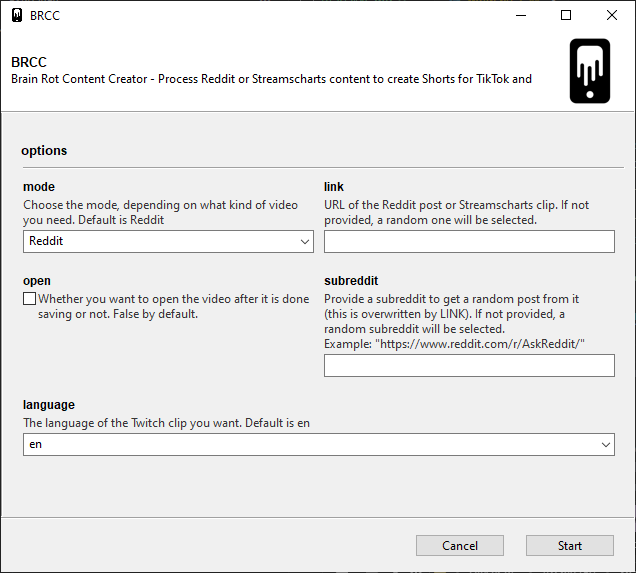

<p align="center">
  <picture>
    <source media="(prefers-color-scheme: dark)" srcset="images/readme_logo_dark.png">
    
  </picture>
</p>

# Brainrot Content Creator

The Brainrot Content Creator (BRCC) turns Reddit threads and Streamcontent (Twitch) clips into ready-to-upload short form content: TikTok voices reading the post, gameplay footage underneath, background music and word-by-word subtitles.  
Yes, exactly the kind of stupid video you'd see on YouTube Shorts for a second before scrolling away again.  
Give it a link, a subreddit or nothing at all, and it picks a post, records it, voices it, edits it and saves the finished 1080x1920 video, automatically letting the full screenshot being read out loud before switching to the next one.

<p align="center">
  <picture>
    
  </picture>
</p>

## Features

- **Reddit mode:** Screenshots a post and chosen top-level comments, reads everything aloud with random TikTok TTS voices and stacks the screenshots on top of random gameplay. Comments that would push the video past 60 seconds are left out.
- **Twitch mode:** Downloads a trending clip from [Streamscharts](https://streamscharts.com/clips) in the language you choose, transcribes it with Whisper and adds big word-by-word subtitles. The clip goes on top, gameplay at the bottom.
- **Random or specific:** Pass a link, a subreddit, or nothing and let it pick a random post from a list of popular subreddits. Posts and clips you've already made a video of are skipped.
- **GUI or CLI:** Opens a [Gooey](https://github.com/chriskiehl/Gooey) GUI by default; add `--ignore-gooey` to use it from the command line.
- **Ready to upload:** Background music at 10% volume, the title plus hashtags in `info.txt`, and a note of which gameplay and music file was used.

## Requirements

- Windows only
- Python 3.9 or newer
- [FFmpeg](https://ffmpeg.org/) for reading and writing video
- [ImageMagick](https://imagemagick.org/) for the Twitch subtitles. If MoviePy can't find it, set the `IMAGEMAGICK_BINARY` environment variable to your `magick.exe`

```sh
pip install -r requirements.txt
playwright install chromium
```

### Resources

The `resources` folder is gitignored, so you have to bring your own files:

```
resources/
          gameplay/   background gameplay videos, each longer than 60 seconds
          music/      background music
```

A random file from each folder is picked for every video.

## Usage

```sh
# GUI
python main.py

# random post from a random subreddit
python main.py --ignore-gooey

# random post from r/AskReddit, open the result when done
python main.py --ignore-gooey -sub "https://www.reddit.com/r/AskReddit/" -o

# a specific post
python main.py --ignore-gooey -l "https://www.reddit.com/r/AskReddit/comments/..."

# random German Twitch clip
python main.py --ignore-gooey -m Twitch -lang de
```

| Option | Description |
| --- | --- |
| `-m`, `--mode` | `Reddit` (default) or `Twitch` |
| `-l`, `--link` | URL of a Reddit post or Streamscharts clip. Random if left out |
| `-sub`, `--subreddit` | Subreddit to pick a random post from. Ignored if `--link` is given |
| `-lang`, `--language` | Language of the Twitch clip (`en` by default) |
| `-o`, `--open` | Open the folder, the video and `info.txt` when done |

### Output

Everything ends up in `FINISHED/`:

| Mode | Folder | Contents |
| --- | --- | --- |
| Reddit | `FINISHED/Reddit/<OP> - <date>/` | `result.mp4`, `info.txt`, `text.txt` (everything that was read out), the screenshots and the TTS audio |
| Twitch | `FINISHED/Twitch/<language>/<title> - <streamer>/` | `result.mp4`, `info.txt` |

## Disclaimer

BRCC is not affiliated with Reddit, Twitch, Streamscharts, TikTok or YouTube. The posts, comments and clips it downloads belong to their creators. You are responsible for following each platform's terms of service and copyright law before uploading anything it makes.

## License

Released under the [MIT License](LICENSE), © 2024 S1thK3nny.

The one exception is `reddit/tiktokvoice.py`, which keeps its own MIT license (© 2024 markrzv). Its full notice is at the top of that file.
